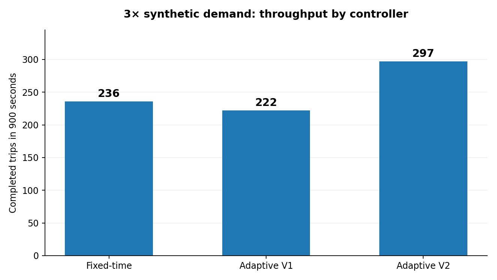
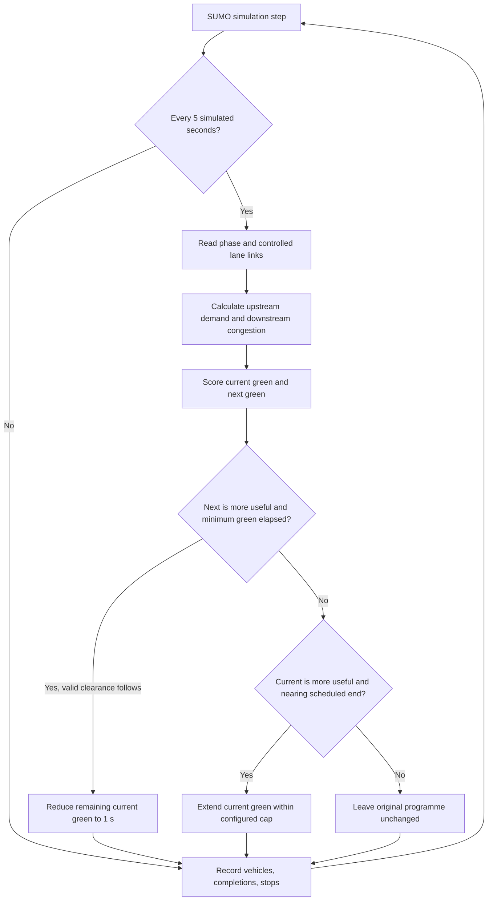
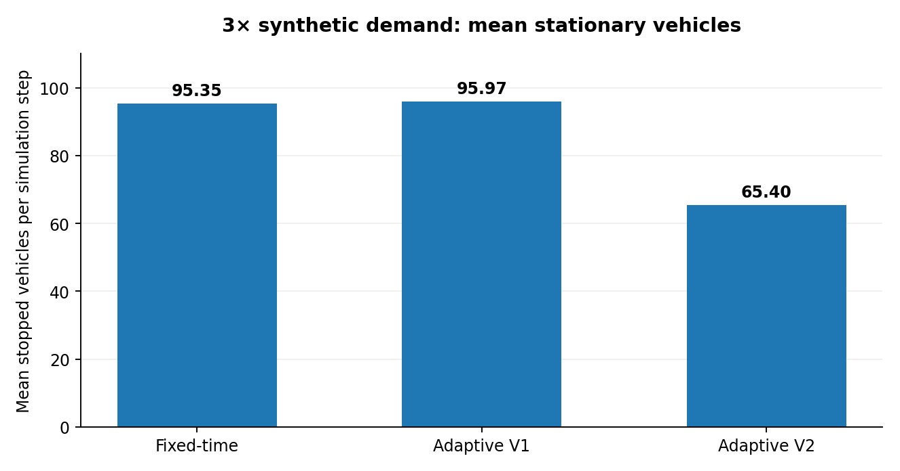
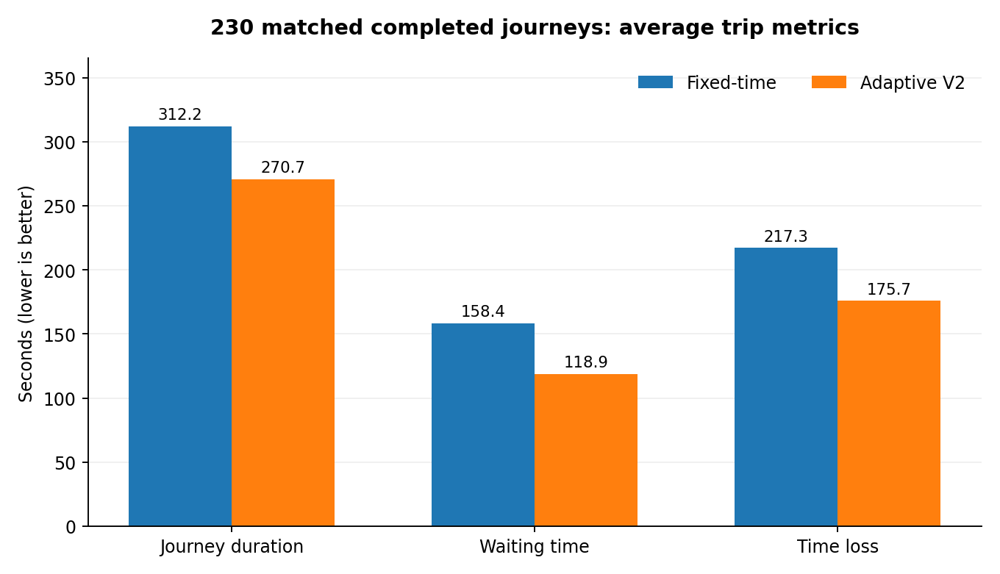
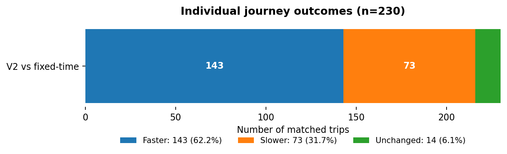

# NairobiTrafficAI — Adaptive V2: Implementation and Experimental Results
**Experiment ID:** V2-3X-42

**Recorded:** 5 November 2026

**Status:** First successful *simulation* result; not yet replicated across seeds, demand profiles, or calibrated Nairobi observations

**Project:** NairobiTrafficAI · Nairobi, Kenya

**Code:** `controllers/adaptive_controller_v2.py`

**Previous overview:** [PROJECT_REPORT.md](PROJECT_REPORT.md) (earlier report, last updated before V2 validation)

> **Evidence boundary:** These measurements describe a *synthetic 900-second SUMO experiment*, **not measured changes to Nairobi's real traffic**. The 103 signal controllers were inferred automatically from imported road geometry. Traffic volume, routes, signal plans, vehicles and timings are not yet calibrated to field data. Do not advertise the percentages below as real-world reductions in travel time or congestion.

## 1. Executive findings
Adaptive V2 uses *upstream demand, downstream queues and occupancy* to decide whether to prolong a productive green or shorten a less useful green, keeping SUMO's existing phase sequence. In the initial high-demand scenario, V2 outperformed the fixed-time baseline and Adaptive V1 on network throughput and average stopped vehicles.

| Headline outcome | Fixed-time | Adaptive V2 | Change vs fixed-time |
|---|---:|---:|---:|
| **Completed trips at 900 s** | 236 | **297** | **+61 (+25.85%)** |
| **Mean stopped vehicles** | 95.35 | **65.40** | **−29.95 (−31.41%)** |
| Vehicles still running at 900 s | 245 | 186 | −59 |
| Started jam-related teleports | 1 | 0 | −1 |
| Eligible traffic-light controllers | 103 | 103 | No change |

In the **230 journeys completed in both fixed-time and V2 runs**, average journey duration decreased from **312.17 s to 270.68 s (−13.29%)**, waiting time from **158.37 s to 118.88 s (−24.94%)**, and time loss from **217.29 s to 175.71 s (−19.14%)**. V2 was faster for **143/230 (62.17%)** matched completed journeys.

These are **single-run, descriptive** improvements. Matched completed journeys are a selected population; trips that remain unfinished must also be analysed when making system-wide claims.



## 2. Simulation setup and reproducibility
| Property | Configuration |
|---|---|
| Simulator | Eclipse SUMO **1.28.0** (command-line / headless) |
| Client/controller | Python + TraCI |
| Development hardware | MacBook Pro M5 (Apple Silicon), macOS |
| Network / scenario | `2026-11-03-16-39-48/osm.sumocfg` |
| Road geometry | OpenStreetMap-based Nairobi area generated with SUMO OSM Web Wizard |
| Signal plan network | `osm.tls.net.xml.gz`, generated with `netconvert --tls.guess true --tls.guess.threshold 30` |
| Detected/eligible signals | **103 / 103** |
| Trial horizon | `--begin 0 --end 900` (900 simulated seconds) |
| Demand scaling | `--scale 3` |
| Random seed | `--seed 42` |
| Trip recording | `--tripinfo-output.write-unfinished true` |
| Status | Fixed, V1 and V2 run on the same *scenario configuration*; observed vehicle counts differ slightly |

**Reproduction commands** (from the project root, with the virtual environment active):

```bash
cd ~/Documents/NairobiTrafficAI
source .venv/bin/activate
# Rebuild each results file, if required. Existing outputs may be overwritten.
python controllers/fixed_time.py
python controllers/adaptive_controller.py
python controllers/adaptive_controller_v2.py
# The comparison script must load fixed_3x_tripinfo.xml and
# adaptive_v2_3x_tripinfo.xml (see Section 6).
python evaluation/compare_controllers.py
```

If fixed-time/V1 scripts have since been parameterised differently, **confirm they are configured for seed 42, 3× scale and 900 s** before rerunning. Also confirm `osm.sumocfg` still references the same signalised network and route files. Record SUMO version, Git commit hash, scenario checksums, and the exact command line for future trials.

**Outputs for this experiment:**

```text
results/
├── fixed_3x_metrics.csv
├── fixed_3x_tripinfo.xml
├── adaptive_3x_metrics.csv
├── adaptive_3x_tripinfo.xml
├── adaptive_v2_3x_metrics.csv
└── adaptive_v2_3x_tripinfo.xml
```

The report documents observed outputs; it does not embed or recreate raw trip records. Keep raw CSV/XML results backed up if `results/` is ignored by Git.

## 3. How Adaptive V2 works
### 3.1 Controller concept
The V2 implementation is a *pressure-inspired traffic signal timing heuristic*, executed centrally in one Python process across all 103 intersections. It is **not yet** a network-wide optimisation solver, trained AI model, or formal max-pressure controller. Each signal decision considers the currently green movements and a future green phase; decisions use locally observed incoming and outgoing lanes, with a shared lane-measurement cache per interval.



### 3.2 Pressure computation
For a given incoming lane and its candidate outgoing movement:

```text
approaching        = max(0, incoming_vehicle_count - incoming_halted)
upstream_demand    = incoming_halted + 0.25 * approaching
raw_pressure       = max(0, upstream_demand - 0.5 * outgoing_halted)
downstream_freedom = max(0, 1 - outgoing_occupancy_percent / 100)
movement_pressure  = raw_pressure * downstream_freedom
```

For a green phase, the implementation retains the *maximum estimated movement pressure per incoming lane*, then sums these values to avoid double-counting incoming lanes that appear in multiple controlled links. This is an intentionally simplified heuristic; it does not model turning shares or lane-specific storage capacity in detail.

### 3.3 Decision rules in initial V2
| Setting | Value | Purpose |
|---|---:|---|
| `DECISION_INTERVAL` | 5 s | Check candidate signal decisions periodically |
| `MIN_GREEN` | 12 s | Do not shorten greens before this elapsed time |
| `MAX_EXTRA_GREEN` | 10 s | Upper bound on added phase duration relative to the nominal phase |
| `GREEN_EXTENSION` | 5 s | Size of a green extension when justified |
| `MIN_PRESSURE` | 1.5 | Minimum candidate pressure for action |
| `SWITCH_ADVANTAGE` | 1.5 | Required advantage of the next green for early termination |
| `EXTEND_ADVANTAGE` | 1.0 | Required advantage of the current green for extension |
| `DOWNSTREAM_WEIGHT` | 0.5 | Penalise downstream queues |
| `APPROACH_WEIGHT` | 0.25 | Account for non-stopped approaching vehicles |

**Early ending:** In an eligible static, sequential programme, when the active phase is green, at least 12 s have elapsed, a recognised yellow/all-red transition follows immediately, and the future green's pressure exceeds the current pressure by the specified margin, set the remaining green to 1 s. SUMO subsequently advances through the existing phase sequence.

**Green extension:** If the active green is nearly finished and its pressure meaningfully exceeds the upcoming green's, extend remaining time by up to 5 s, subject to nominal duration + 10 s. Otherwise leave the signal unchanged.

**Not guaranteed by this code:** certified signal clearance timing, pedestrian crossing service, starvation prevention for every movement, real-world fault tolerance, fairness across road users, or safety of the automatically guessed signal programmes. This controller must **never** be connected to live public signals without a separate approved safety/control architecture.

### 3.4 Recorded actions
| V2 decision statistic | Count |
|---|---:|
| Traffic signals detected | 103 |
| Eligible for control | 103 |
| Green extensions | **61** |
| Early green endings | **235** |
| Started jam-related teleports | **0** |

A large number of early endings is consistent with V2 freeing capacity sooner, but **it does not prove** that early endings alone caused the improvement. An ablation experiment is required: V2 extension-only, early-ending-only, and both enabled, with all else held constant.

## 4. Overall network results: fixed vs V1 vs V2
| Measurement | Fixed-time | Adaptive V1 | Adaptive V2 |
|---|---:|---:|---:|
| Vehicles inserted / departed | 481 | 482 | **483** |
| Completed by 900 s | 236 | 222 | **297** |
| Still running at 900 s | 245 | 260 | **186** |
| Still waiting to enter network | 11 | 10 | **9** |
| Mean number of stopped vehicles per simulation step | 95.35 | 95.97 | **65.40** |
| Started jam-related teleports | 1 | 0 | **0** |
| SUMO console average duration, including unfinished observations | 308.37 s | 313.67 s | **268.21 s** |
| SUMO console average waiting time, including unfinished observations | 178.39 s | 179.18 s | **121.84 s** |
| SUMO console average time loss, including unfinished observations | 233.54 s | 237.72 s | **179.83 s** |

The console's trip statistics are **not a completed-trip-only apples-to-apples comparison**: because `--tripinfo-output.write-unfinished true` is enabled, unfinished trips contribute partial values at simulation cutoff. In addition, the trials inserted 481, 482 and 483 vehicles, so demand realisation is not perfectly identical.




### Derived changes from fixed-time to V2
\- Completed journeys: **297 − 236 = 61 additional**, or **+25.85%** relative to fixed-time.

\- Mean stopped vehicles: **65.40 − 95.35 = −29.95**, or **−31.41%**.

\- Still running at the 900-second boundary: **186 rather than 245** (59 fewer).

\- No jam-related teleports observed in V2, compared with one in fixed-time.

For a rigorous future throughput comparison, use an identical pre-generated route/demand file, report all vehicles due to depart, and account for inserted, waiting-to-enter, unfinished, completed and teleported vehicles separately.

## 5. Matched completed journeys: fixed vs V2
`evaluation/compare_controllers.py` matched trip IDs that had `arrival >= 0` in **both** `fixed_3x_tripinfo.xml` and `adaptive_v2_3x_tripinfo.xml`.

| Trip matching category | Number |
|---|---:|
| Completed in fixed-time | 236 |
| Completed in V2 | 297 |
| Completed in both | **230** |
| Completed only in fixed-time | 6 |
| Completed only in V2 | **67** |

### Average trip metrics on the same 230 IDs
| Metric | Fixed-time | Adaptive V2 | Difference (V2−fixed) | Relative difference |
|---|---:|---:|---:|---:|
| Journey duration | 312.17 s | **270.68 s** | **−41.49 s** | **−13.29%** |
| Waiting time | 158.37 s | **118.88 s** | **−39.49 s** | **−24.94%** |
| Time loss | 217.29 s | **175.71 s** | **−41.58 s** | **−19.14%** |



### Trip-by-trip direction of change
| Outcome | Matched trips | Fraction of 230 |
|---|---:|---:|
| V2 faster | **143** | **62.17%** |
| V2 slower | 73 | 31.74% |
| Unchanged | 14 | 6.09% |



**Interpretation:** V2 reduces average duration and waiting time for this *matched, completed subset*. However, 73 matched journeys became slower, and matching only finished journeys creates selection bias. There were 67 V2-only completed trips and 6 fixed-only completed trips, which are outside these travel-time averages. Different insertion counts and possible demand-realisation differences also warrant controlled reruns.

## 6. Comparison script configuration
To reproduce the fixed-time vs V2 paired comparison, ensure the two input lines in `evaluation/compare_controllers.py` are:

```python
fixed = load_trips("fixed_3x_tripinfo.xml")
adaptive = load_trips("adaptive_v2_3x_tripinfo.xml")
```

Then run:

```bash
python evaluation/compare_controllers.py
```

**Expected checkpoint from the recorded run:**

```text
Fixed-time completed: 236
Adaptive V2 completed: 297
Completed in both: 230
Fixed-only completions: 6
V2-only completions: 67
Journey duration: fixed 312.17 s / V2 270.68 s (-13.29%)
Waiting time:     fixed 158.37 s / V2 118.88 s (-24.94%)
Time loss:        fixed 217.29 s / V2 175.71 s (-19.14%)
Faster journeys:  143/230
Additional completed journeys: +61 (+25.85%)
```

If results differ materially, first inspect the command-line configuration, scenario/route files, SUMO version and seed. **Do not overwrite the original experiment artifacts without retaining a copy** if exact reproducibility matters.

## 7. Threats to validity and engineering risks
| Risk | Consequence | Proposed control |
|---|---|---|
| Synthetic route demand and inferred traffic lights | Findings may not generalise to real Nairobi traffic | Obtain signal inventories, turn counts and observed travel-time distributions; calibrate in SUMO |
| One random seed, one demand multiplier | May overstate reliable gains | Repeat seeds 1–10 at demand scales 1×, 3× and 5×; report distributions and uncertainty |
| Different vehicles inserted across runs (481 vs 483) | Not perfectly matched experimental exposure | Pre-generate identical demand/route definitions; log departed and pending vehicles |
| Partial records written for unfinished trips | Console means are not completed-trip means | Report finished-only journey metrics, censored/unfinished counts, and network-wide person-hours |
| Paired matches require completion in both runs | Selection bias in trip-time comparisons | Report completion populations and all-trip metrics alongside paired results |
| Heuristic pressure and simple cyclic programmes | Local improvements may hide unfair queue growth | Per-movement max red, 95th-percentile delay, spillback and phase fairness diagnostics |
| Automatically inferred phase plans | Simulator plans not necessarily real or safe | Validate approaches, pedestrian crossings, conflict matrices, clearance and minimum service |
| One intervention at a time is untested | Can't attribute gains to the two V2 action types | Run ablations and parameter sweeps |
| OSM / vehicle-mode simplifications | Excludes real road-user mixes | Model buses, matatus, motorcycles, pedestrians, incidents, turning flows and priority vehicles |
| No live communications/controller integration | Not yet deployable | Build read-only shadow-mode first; require independent safety and fallback controls |

## 8. Recommended next experiments
### Stage A — Repeated-seed validation
1\. Freeze and tag the code, environment, input network and demand artefacts.

2\. Test fixed-time, V1 and V2 at **1×, 3× and 5×** across **seeds 1–10**.

3\. Ensure each controller within a seed/scale pair uses exactly the same demand definition.

4\. Aggregate completed trips, unfinished trips, stopped-vehicle means, waiting times, delays, teleports and queue spillback.

5\. Report paired seed-level improvement and its spread; do not cherry-pick the best run.

### Stage B — Ablation and fairness checks
\- Compare green-extension-only, early-ending-only, both, and neither.

\- Record per-signal and per-approach red-time distributions; flag starvation.

\- Inspect the 73 matched journeys that became slower and where they occur.

\- Analyse queue growth and downstream spillback on neighboring intersections.

\- Test wider demand distributions and disrupted roads/incident scenarios.

### Stage C — Platform work
\- Build a browser map/dashboard that reads SUMO network coordinates and per-step controller/vehicle metrics.

\- Add a live simulation timeline, per-intersection diagnostics and side-by-side experiments.

\- Implement explicit adjacent-junction coordination and progression only after robust baseline testing.

\- Add audit logs, configuration versioning, safe-mode fallback, and a read-only pilot architecture.

## 9. Repository and publishing notes
Recommended repository paths:

```text
NairobiTrafficAI/
├── controllers/
│   ├── fixed_time.py
│   ├── adaptive_controller.py
│   └── adaptive_controller_v2.py
├── evaluation/
│   └── compare_controllers.py
├── docs/
│   ├── PROJECT_REPORT.md                # Earlier historical report
│   ├── ADAPTIVE_V2_RESULTS.md            # This report
│   └── assets/
│       ├── v2_completed_journeys.png
│       ├── v2_stopped_vehicles.png
│       ├── v2_matched_journey_metrics.png
│       └── v2_matched_trip_outcomes.png
└── results/                              # CSV/XML outputs; may be gitignored
```

When these Markdown and asset files are committed together, GitHub renders the tables, Mermaid diagram and image charts. If using GitHub Pages, link this document from the main report or add it to the site navigation.

To stage only the documentation, from the repository root:

```bash
git add docs/ADAPTIVE_V2_RESULTS.md docs/assets/v2_*.png
git status
git commit -m "Document Adaptive V2 simulation results and validation limits"
# Push only after reviewing the staged files
```

**Document classification:** Internal experimental record suitable for public sharing *with its simulation/evidence disclaimer retained*. Any investor-facing claims should cite additional repeatability studies and calibrated field data.
