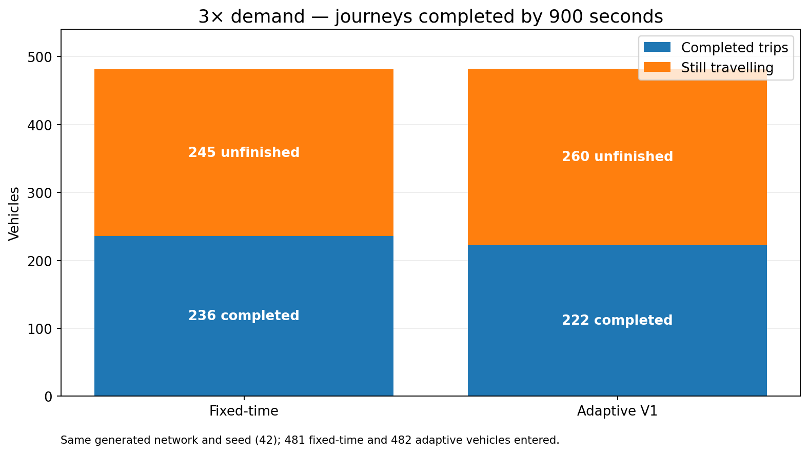
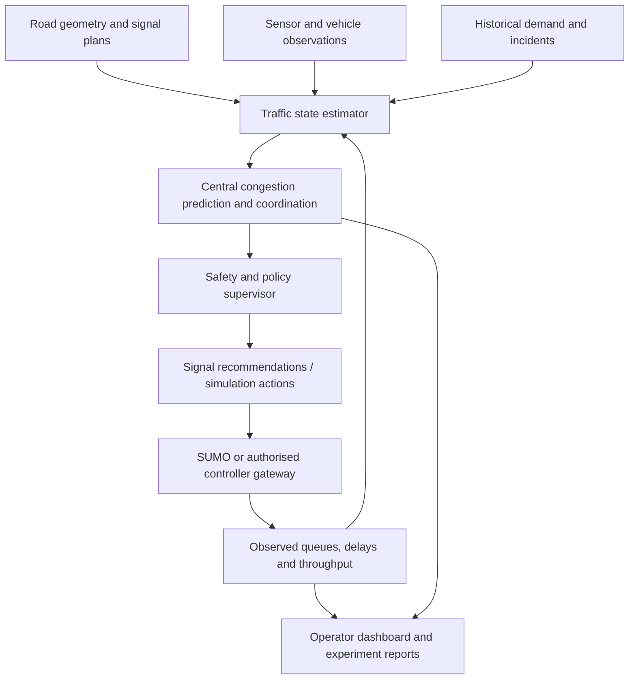
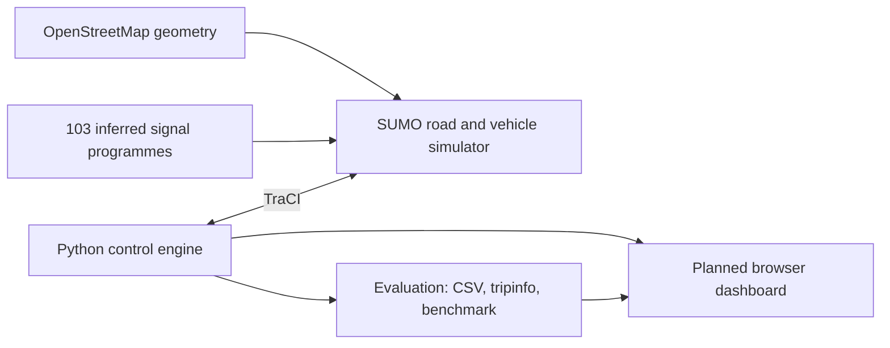
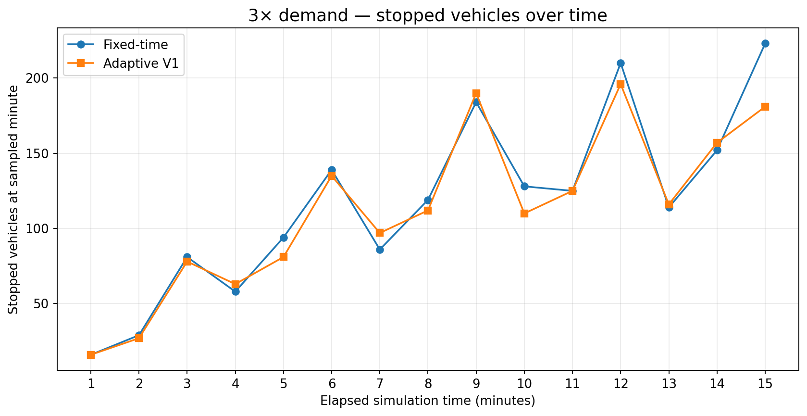
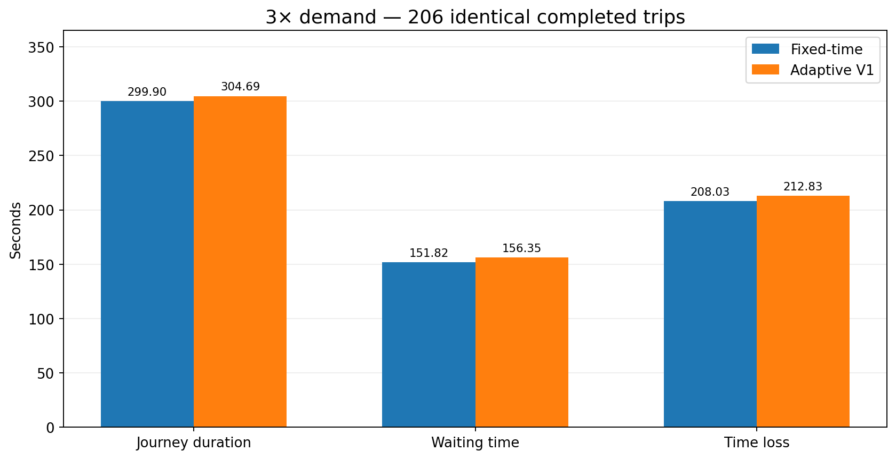
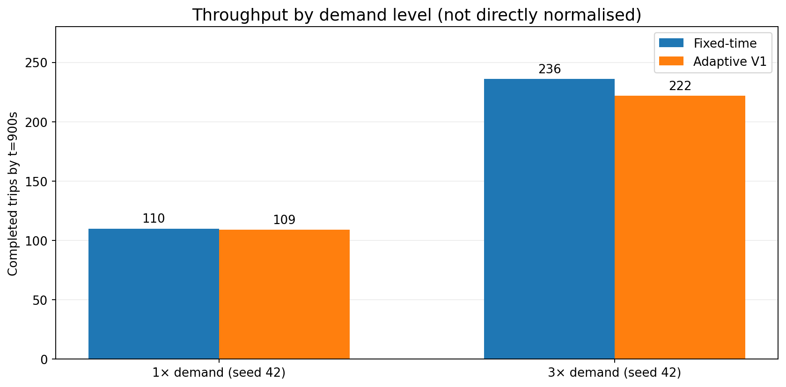
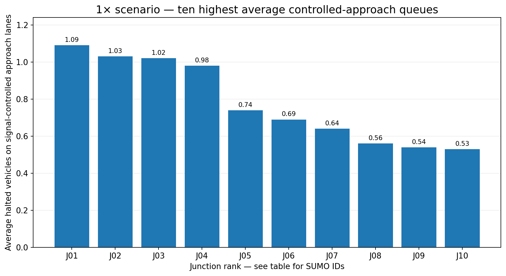
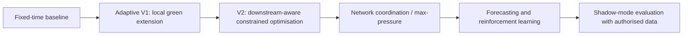
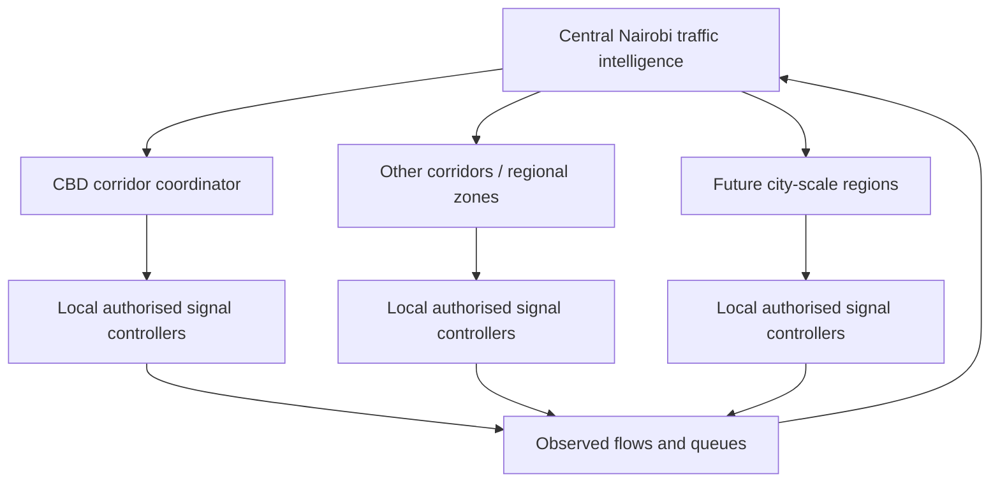

# NairobiTrafficAI — Research, Experiments & Startup Development Log

**Project:** NairobiTrafficAI  
**Focus:** AI-assisted, network-wide traffic signal optimisation for Nairobi, Kenya  
**Status:** Fixed-time and Adaptive V1 benchmarks completed; Adaptive V2 concept drafted, not yet validated  
**Report date:** 3 November 2026  
**Simulation stack:** SUMO 1.28.0, Python, TraCI, OpenStreetMap  
**Hardware:** MacBook Pro with Apple Silicon (M5), macOS, zsh

> **Evidence boundary.** All performance values in this document come from synthetic SUMO experiments reported during project development. The imported map is based on Nairobi road geometry, but the 103 signal controllers were **automatically inferred** and are **not verified physical traffic-light installations**. Vehicle demand, modal mix and signal timings have not been calibrated with real Nairobi data. Results do not measure real-world improvements or justify controlling live signals.

## Contents

1. [Executive summary](#1-executive-summary)
2. [Startup vision and commercial hypothesis](#2-startup-vision-and-commercial-hypothesis)
3. [Technical architecture](#3-technical-architecture)
4. [Environment, data and setup record](#4-environment-data-and-setup-record)
5. [Simulation experiments and results](#5-simulation-experiments-and-results)
6. [Congestion analysis of the 103 controllers](#6-congestion-analysis-of-the-103-controllers)
7. [Interpretation, limitations and lessons](#7-interpretation-limitations-and-lessons)
8. [Adaptive V2 and system roadmap](#8-adaptive-v2-and-system-roadmap)
9. [Reproduction instructions](#9-reproduction-instructions)
10. [Customer validation and go-to-market](#10-customer-validation-and-go-to-market)
11. [Experiment register and next actions](#11-experiment-register-and-next-actions)
12. [Read the Adaptive V2 Research Report](ADAPTIVE_V2_RESULTS_pages_ready.html)

---

## 1. Executive summary

NairobiTrafficAI is a proposed **private software company** developing an intelligence layer for adaptive traffic signal management, initially in Nairobi and potentially across East Africa. Its long-term product vision is a central, network-aware system that predicts congestion and coordinates existing junction equipment. The first commercial product may be **traffic simulation, analytics and signal-timing recommendations**, rather than autonomous control of public lights.

**What has been built and demonstrated:**

- Imported a portion of Nairobi road geometry using SUMO's OpenStreetMap Scenario Wizard.
- Executed a **900-second** simulation of the network via command-line SUMO, avoiding a graphical rendering issue on the Mac.
- Generated **103 experimental traffic-light controllers** using `netconvert --tls.guess` and confirmed access to all 103 through Python/TraCI.
- Benchmarked fixed-time control and a simple green-extension **Adaptive V1** controller at **1×** and **3×** synthetic demand.
- Identified the ten busiest signal-controlled approach groups under a 1× baseline.
- Captured reproducible trip output and compared **206 matching completed vehicles** in the 3× experiment.

**Latest finding:** Adaptive V1 performed worse than fixed-time control at 3× demand: **222 vs 236 completed journeys**, and **304.69 s vs 299.90 s** average journey duration for the **206 matched completed trips**. This is a valuable negative result: local green extensions alone do not reliably improve network-wide conditions.



## 2. Startup vision and commercial hypothesis

### Product proposition

> Predict congestion, simulate interventions and optimise Nairobi's traffic network — starting with an auditable decision-support platform, and progressing to authorised signal integration only after safety validation.

**Company type:** Independent/private B2B software venture.  
**Initial geography:** Nairobi, Kenya.  
**Potential expansion:** Other Kenyan urban centres, then East African cities.  
**Potential customers:** Traffic engineering consultancies, intelligent transport system (ITS) integrators, private-site traffic operators and, ultimately, authorised road agencies.

### First commercially credible wedge

1. **Traffic intelligence:** Scenario modelling, queue diagnostics and congestion prediction using available data.
2. **Signal optimisation:** Offline recommendations accompanied by transparent before/after simulation evidence.
3. **Shadow-mode pilot:** Read live or recorded traffic data where permission exists, without altering actual signals.
4. **Approved live integration:** Only after agreements with infrastructure owners, safety evaluation, cybersecurity review and appropriate regulatory processes.

**Differentiation to investigate:** Hardware-independent software; network-level rather than isolated-junction decisions; Nairobi-relevant modes such as matatus, motorcycles and buses; passenger-weighted delay; limited-data operation; resilient fallback modes. These are *product hypotheses*, not proven competitive advantages.

**Commercial research note:** Kenya's existing and planned intelligent transport investments, procurement structures and suppliers should be verified against current primary sources before a pitch or customer proposal. Do not represent previously discussed market-size or contract figures as validated revenue opportunities.

## 3. Technical architecture

### Proposed platform



### Development architecture



### Software components

| Component | Existing / proposed tool | Role |
|---|---|---|
| Traffic simulation | SUMO 1.28.0 | Vehicle movement, junctions and signal state |
| Signal API | `traci` | Python-driven observation and control |
| Map import | SUMO OSM Web Wizard and `netconvert` | Network preparation |
| Analysis | Python, CSV, XML | Metrics, paired comparisons, reproducibility |
| Adaptive V1 | Python | Bounded green extensions based on local queues |
| Adaptive V2 (planned) | Pressure-based controller | Incorporate downstream congestion and phase decisions |
| Dashboard (planned) | React/MapLibre + Python API | Visible map, congestion status and simulations |
| Future learning component | PyTorch or similar | Reinforcement learning after conventional benchmarks |

**Safety design principle:** The central optimiser may recommend plans, but physical local controllers must retain certified intergreen intervals, pedestrian protection, conflict prevention and safe behaviour during communications failure. Present Python code is **simulation-only**.

## 4. Environment, data and setup record

### Confirmed environment

| Area | Details |
|---|---|
| Laptop | MacBook Pro M5 / Apple Silicon (`arm64`) |
| Terminal | zsh |
| SUMO | **1.28.0**, working via `sumo --version` and `sumo-gui --version` |
| SUMO framework | `/Library/Frameworks/EclipseSUMO.framework` |
| Original Python | 3.14.7 |
| Project Python | Python 3.12 virtual environment (`.venv`) |
| Python packages verified | `traci`, `sumolib`; `pandas` and `matplotlib` installed during setup |
| Project directory | `~/Documents/NairobiTrafficAI` |
| Scenario directory | `2026-11-03-16-39-48` |

### Critical scenario files

| Path relative to project root | Role |
|---|---|
| `2026-11-03-16-39-48/osm.sumocfg` | Main SUMO configuration |
| `2026-11-03-16-39-48/osm.net.xml.gz` | Original imported network, initially 0 signal controllers |
| `2026-11-03-16-39-48/osm.tls.net.xml.gz` | **Network with 103 inferred traffic-light controllers** |
| `2026-11-03-16-39-48/osm.passenger.trips.xml` | Generated passenger demand input |
| `2026-11-03-16-39-48/osm_pt.rou.xml` | Public-transport route data generated by wizard |
| `controllers/check_lights.py` | TraCI connectivity test |
| `controllers/fixed_time.py` | Unmodified fixed-time baseline |
| `controllers/adaptive_controller.py` | Green-extension Adaptive V1 |
| `evaluation/analyze_congestion.py` | Controlled-approach bottleneck analysis |
| `evaluation/compare_controllers.py` | Matched-completed-trip comparison |

The file name in this report is `analyze_congestion.py`, matching the command successfully run. Earlier instructions also referred to an `analyse_congestion.py` spelling.

### Setup and debugging history

- SUMO's package supplied `SUMO sumo-gui.app`, `SUMO netedit.app` and `SUMO Scenario Wizard.app`.
- `SUMO_HOME` was initially pointed to the framework executable root. The Scenario Wizard expected data under `share/sumo`, and generated a typemap-not-found error. Running the wizard with a temporary corrected `SUMO_HOME` allowed map conversion to succeed.
- OSM downloads intermittently returned an HTTP 502 and an earlier scenario attempt failed to find a downloaded `.osm.xml.gz` file. A subsequent attempt succeeded.
- OSM conversion produced geometry/restriction warnings; these should be checked when validating the network.
- `proj.db` lookup warnings remain; correct PROJ data configuration should be investigated.
- The native graphical renderer hit X/GLX errors on the Mac. **Headless SUMO works** and is the validated experiment runner. A browser dashboard is planned as the visual front end.
- SUMO still prints a `SUMO_HOME is not set properly` warning with the current shell setup. It does not prevent headless simulation, but should be cleaned up before automation or deployment.

### Signal generation

Original network: **0** traffic lights. After running a `netconvert` pass with `--tls.guess true --tls.guess.threshold 30`, SUMO yielded **103** controllers. Three attempted signals could not be built because they controlled no links. The final count was verified both through `sumolib.net.readNet(...).getTrafficLights()` and TraCI `trafficlight.getIDList()`.

The automatically generated signal layout is an experimental configuration. It is **not** evidence that central Nairobi contains exactly 103 operational signals in the selected area.

## 5. Simulation experiments and results

### Experimental method

- Network: same generated Nairobi geometry and 103-controller signal network for the controlled comparisons.
- Horizon: **900 seconds** (15 minutes).
- Demand: `--scale 1` (original synthetic trips) or `--scale 3` (threefold synthetic demand).
- Reproducibility seed for later runs: `--seed 42`.
- Fixed-time control: preserve SUMO-generated signal programmes.
- Adaptive V1: inspect signal-controlled approach queues; extend suitable existing green phases by a limited amount; do not directly inject arbitrary signal strings.
- Data capture: per-second metrics CSV and SUMO `tripinfo` XML, including unfinished trips for latest experiments.

### 5.1 Initial 1× comparison: no signals vs generated signals

This was an **exploratory diagnostic**, not a valid operational comparison of traffic-light safety or equal completion cohorts.

| Metric | No inferred signals | 103 generated signals |
|---|---:|---:|
| Vehicles inserted | 164 | 164 |
| Completed by 900 seconds | 137 | 107 |
| Still running at 900 seconds | 27 | 57 |
| Reported average journey duration (completed) | 129.91 s | 271.39 s |
| Reported average waiting time | 0.50 s | 123.68 s |
| Reported average time loss | 20.53 s | 166.66 s |

**Interpretation:** Generated signals introduced substantial stop-related delay at low synthetic demand. The no-signal network is a diagnostic reference only; it may represent unsafe crossing conditions. The completed-vehicle populations also differ, so **do not claim a causal 109% real-world increase**.

### 5.2 Seeded 1× controlled comparison

| Metric | Fixed-time | Adaptive V1 |
|---|---:|---:|
| Vehicles inserted | 164 | 164 |
| Completed | 110 | 109 |
| Still running | 54 | 55 |
| Average stopped vehicles | 19.20 | 19.23 |
| Reported mean duration, **including unfinished records** | 233.59 s | 234.98 s |
| Reported mean waiting, **including unfinished records** | 105.34 s | 105.54 s |
| Reported mean time loss, **including unfinished records** | 142.35 s | 143.47 s |
| Adaptive green extensions | 0 | 26 |

Matched-completed-trip comparison (109 vehicles in both): **263.32 s fixed vs 264.72 s adaptive** journey duration; **115.07 s vs 115.84 s** waiting; **157.49 s vs 158.82 s** time loss. **24/109** matched vehicles were faster with Adaptive V1.

### 5.3 Threefold demand (3×) — primary benchmark

The demand multiplier raised traffic to about 492 loaded trips. At 900 seconds, both simulations had significant unfinished demand and queueing.

| Metric | Fixed-time | Adaptive V1 | Observed result |
|---|---:|---:|---|
| Vehicle records inserted | 481 | 482 | Different actual departures under congestion |
| Completed trips | **236** | **222** | V1 completed **14 fewer** (-5.9% relative to fixed) |
| Still running | 245 | 260 | V1 left 15 more on-road |
| Waiting to enter | 11 | 10 | Both had uninserted demand |
| Average stopped vehicles per sampled second | **95.35** | **95.97** | V1 slightly worse |
| Reported mean duration, including unfinished | 308.37 s | 313.67 s | Not final travel time for all vehicles |
| Reported mean waiting, including unfinished | 178.39 s | 179.18 s | V1 slightly worse |
| Reported mean time loss, including unfinished | 233.54 s | 237.72 s | V1 worse |
| Teleports | 1 (jam) | 0 | A teleport is an artificial gridlock resolution |
| Green extensions | 0 | 270 | More intervention did not mean better throughput |
| Processing time | 3.36 s | 14.21 s | V1 had substantial TraCI overhead |




#### 206 matched completed journeys — fairer per-vehicle diagnostic

| Metric | Fixed-time | Adaptive V1 | Adaptive change |
|---|---:|---:|---:|
| Duration | 299.90 s | 304.69 s | **+4.79 s (+1.60%)** |
| Waiting time | 151.82 s | 156.35 s | **+4.53 s (+2.99%)** |
| Time loss | 208.03 s | 212.83 s | **+4.80 s (+2.31%)** |

**68 of 206** matched completed journeys were faster under Adaptive V1 (about 33%). V1 also completed fewer trips overall. The matched group omits trips finishing in only one condition, so these values cannot be presented as complete citywide mean travel time.



#### Demand-level reference



The higher raw number of completed journeys at 3× does **not** imply higher efficiency: substantially more vehicles were introduced, and the unfinished share was much higher.

### 5.4 Why an apparent 21% improvement was rejected

A previous comparison reported **109 adaptive completions** even though the latest 3× adaptive run had **222**. It had inadvertently compared mismatched experiment outputs, apparently including an old 1× file. The reported **-21.08% journey time** finding was **invalid**. The file names were corrected and the 206-matched-trip 3× results above are the trustworthy current benchmark.

This is a core experimental lesson: always print exact input paths and confirm trip counts before interpreting a graph.

## 6. Congestion analysis of the 103 controllers

A separate **1×**, fixed-time, seed-42, 900-second run measured halted vehicles on each traffic-light controller's unique controlled approach lanes, sampled every five seconds.

| Rank | SUMO traffic-light controller ID | Average halted vehicles | Peak halted |
|---:|---|---:|---:|
| 1 | `cluster_12076062757_30986871` | 1.09 | 6 |
| 2 | `cluster_2713512388_2713512394_6369992443_6369992451` | 1.03 | 6 |
| 3 | `cluster_10873342297_56230784` | 1.02 | 4 |
| 4 | `cluster_56233482_6369992441` | 0.98 | 4 |
| 5 | `cluster_12168049897_12168049898_1295903336_1295903343_#4more` | 0.74 | 4 |
| 6 | `282040201` | 0.69 | 3 |
| 7 | `cluster_10218504228_6370188407` | 0.64 | 4 |
| 8 | `1026792544` | 0.56 | 3 |
| 9 | `cluster_2713511161_3715965268_3715965269_56232857` | 0.54 | 4 |
| 10 | `cluster_12488453305_296111410` | 0.53 | 3 |



**Caution:** At 1× demand, average controlled-approach queues are small. This does **not** mean the larger 3× run is uncongested, nor that the largest 1× queue is automatically the critical 3× bottleneck. Rerun the same diagnostic under 3× demand and measure downstream occupancy and spillback before deciding where V2 should intervene.

## 7. Interpretation, limitations and lessons

### Findings supported by experiments

1. SUMO 1.28.0 can execute the imported Nairobi network headlessly on Apple Silicon.
2. Python/TraCI can enumerate and observe **all 103** generated traffic-light controllers.
3. The fixed-time network suffers significant waiting under generated demand; 3× load exposes queue buildup, uninserted vehicles and a jam teleport.
4. **Adaptive V1 is not an improvement** under the tested 3× seed-42 conditions. More green extensions can worsen network-level outcomes.
5. Collecting `tripinfo` for unfinished trips and joining records by vehicle ID changes the reliability of analysis.
6. An algorithm that optimises one approach without considering downstream space and competing movements is an insufficient basis for the startup's network-wide promise.

### Limitations to resolve before customer claims

- **Demand calibration:** Generated traffic counts and turning ratios do not reflect measured Nairobi flows.
- **Signal realism:** All 103 controllers are guessed; actual signal locations, phases, pedestrian requirements and junction geometry need verification.
- **Modal mix:** Matatus, motorcycles, passenger counts, freight and pedestrian delays require better representation.
- **Censoring:** A 900-second horizon leaves hundreds of vehicles unfinished at 3×. Full-route travel time comparisons need longer runs, suitable warm-up periods and robust completion/queue measures.
- **Randomness and insertion:** Seed 42 was one run; inserted vehicles differed slightly between controllers (481 vs 482). Repeat with multiple seeds and compare offered demand, departures and arrivals separately.
- **Teleports:** Teleported vehicles are not ordinary completed journeys; record number, locations and reasons.
- **Safety:** In-simulation phase adjustments need detailed validation. No use on real junctions is authorised or implied.
- **Runtime:** V1 requires ~14.21 s vs 3.36 s for fixed-time at 3×; subscriptions/caching and `libsumo` could help future scalability.
- **Network scope:** 103 generated signal controllers in one selected map region are not the complete Nairobi metropolitan signal network.

### Experimental principles going forward

- Keep an unchanged baseline network and route-demand inputs.
- Version every controller and write output names that contain **controller, scale, seed and duration**.
- Benchmark against **fixed-time, SUMO built-in actuated and max-pressure** controllers; compare with AI only after these are strong.
- Include throughput, total time spent in system, stopped vehicle-seconds, queue spillback, fairness across roads, teleport rate and unfinished demand.
- Report both matched-trip statistics **and** network-wide outcomes; do not use matched trips alone to conceal missing completions.
- Use several random seeds and demand profiles rather than choosing one favourable simulation.

## 8. Adaptive V2 and system roadmap

### Algorithm progression



**V2 design concept (not yet tested):** At each of the 103 controlled junctions, estimate current-phase demand, conflicting-phase demand, downstream queue and downstream occupancy. Decide whether to keep or end a valid green within safe minimum/maximum bounds. Preserve existing transition sequences, add anti-starvation safeguards, and avoid extending green into blocked downstream links.

A V2 draft (`controllers/adaptive_controller_v2.py`) was proposed but **has not yet been run, debugged or validated** in the recorded results. It is a **pressure-inspired prototype**, not proof of a working joint global optimiser or production-safe control logic.

### Scale architecture



**Engineering scale ladder:** 103-signal simulation → robust multi-scenario benchmarks → coordinated corridor logic on the full network → graph-based city partitioning → regional coordination → citywide simulation with measured demand → limited authorised shadow-mode pilots. Do not partition controllers by arbitrary numeric ID ranges; use actual road connectivity.

### Browser dashboard direction

The intended GUI is **not merely SUMO's native renderer**. The startup's proposed web dashboard should show map geometry, moving vehicles, signal phase, approach queues, hotspot history, experiment controls, A/B performance and recommendations. It can use SUMO as the backend while avoiding the observed Mac GLX problems.

## 9. Reproduction instructions

Commands are written for the user's existing macOS/zsh project. They assume installed SUMO and the original scenario folder are present.

### Activate environment

```zsh
cd ~/Documents/NairobiTrafficAI
source .venv/bin/activate
sumo --version
python -c "import traci, sumolib; print('TraCI ready')"
```

### Confirm that the signalised network runs

```zsh
sumo -c "2026-11-03-16-39-48/osm.sumocfg" \
  --begin 0 --end 900 --seed 42 --scale 3
```

### Run controller experiments

```zsh
python controllers/fixed_time.py
python controllers/adaptive_controller.py
python evaluation/compare_controllers.py
```

The current controller scripts use these output files:

| Generated file | Description |
|---|---|
| `results/fixed_3x_metrics.csv` | Per-step fixed-time counts |
| `results/fixed_3x_tripinfo.xml` | Fixed-time trip records |
| `results/adaptive_3x_metrics.csv` | Per-step V1 counts |
| `results/adaptive_3x_tripinfo.xml` | V1 trip records |
| `results/junction_congestion.csv` | Ranked 1× bottlenecks |

Because results may be ignored by Git, the tables and figures in this report preserve the measured snapshots. If experiments are to be made independently reproducible, archive versioned output artefacts and complete input manifests in a dedicated release or data storage location.

### Clean up SUMO path configuration (future housekeeping)

The macOS package has a **binary root** and a nested **SUMO resources root**. For an interactive session, the intended arrangement can be tested as:

```zsh
export SUMO_ROOT="/Library/Frameworks/EclipseSUMO.framework/Versions/Current/EclipseSUMO"
export SUMO_HOME="$SUMO_ROOT/share/sumo"
export PATH="$SUMO_ROOT/bin:$PATH"
```

Only persist this to `~/.zshrc` after verifying `sumo --version` and the wizard in a new shell. `PROJ_DATA` and graphics warnings still require independent diagnostics.

### GitHub repository note

A GitHub clone was initially created **inside** the existing project directory, causing `git status` in the outer folder to report `not a git repository`. Confirm the intended Git root with `git rev-parse --show-toplevel` before staging. Keep `.venv/` and large generated `results/` out of routine Git commits; track this Markdown report and `docs/assets/` chart images.

## 10. Customer validation and go-to-market

**Priority buyers to interview:**

1. Traffic engineering consultancies: Who pays for signal studies, and what deliverables do they value?
2. ITS integrators: Which controller vendors and interfaces could support read-only, shadow-mode integration?
3. Nairobi traffic and road authority professionals: Who owns traffic data, signal access and budgets?
4. Large private developments: Can a limited-scope road/access simulation create measurable commercial value?

**First sales proposition:** A **paid, fixed-scope congestion study** with calibrated data, scenario simulation and transparent recommendations. Subscription pricing or autonomous control should be explored only after validating procurement needs and integration costs. Previously discussed fee ranges are **unvalidated pricing hypotheses**, not market quotes.

**20-interview target:** Six engineering consultants, five ITS vendors, five agency professionals and four private-site operators. Ask about existing spending, workflows, data access, procurement, measurable pain and willingness to sign a scoped paid pilot.

**Pilot stages:** Synthetic demonstration → externally validated data → offline simulation → shadow-mode observation → authorised supervised test. Real-world procurement, data protection under Kenyan law, privacy, cybersecurity, pedestrian safety and liability require specialist review.

## 11. Experiment register and next actions

| Milestone | Status | Evidence / output |
|---|---|---|
| Install SUMO, Python/TraCI on M5 Mac | **Done** | SUMO 1.28.0; successful TraCI connection |
| Import Nairobi OSM network | **Done** | Scenario `2026-11-03-16-39-48` |
| Generate and confirm 103 TLS controllers | **Done** | `osm.tls.net.xml.gz`; TraCI count 103 |
| Run original 1× baseline | **Done** | 164 vehicles inserted, 107 completed under generated signals |
| Run seeded 1× fixed vs V1 | **Done** | 110 vs 109 completions |
| Identify 1× controlled-approach hotspots | **Done** | `results/junction_congestion.csv`; top ten table |
| Run 3× fixed vs Adaptive V1 | **Done** | 236 vs 222 completions; tripinfo XML |
| Correct stale comparison-path issue | **Done** | 206 matched trips; V1 +1.60% duration |
| Calibrate network with actual Nairobi counts | **Not started** | Needs data access and transport expertise |
| Implement and validate Adaptive V2 | **Not yet validated** | Separate script; test with fixed seeds |
| Build dashboard | **Planned** | Browser map and telemetry |
| Multi-seed benchmark / uncertainty ranges | **Planned** | Robust repeatable test suite |
| Nairobi customer discovery interviews | **Planned** | 20 interviews / pilot problem validation |

### Immediate next technical actions

- [ ] Save a clean Git commit of controllers, evaluation scripts, `docs/PROJECT_REPORT.md` and `docs/assets/`.
- [ ] Investigate `SUMO_HOME`, `proj.db` and native graphical renderer configuration, without blocking headless experiments.
- [ ] Rerun congestion ranking for **3× traffic**, capturing downstream occupancy and queue spillback.
- [ ] Extend trip-level evaluation with unfinished journeys, road-entry delays and teleport diagnostics.
- [ ] Implement V2 in a **new file**; validate static green/yellow transitions before testing on the entire network.
- [ ] Benchmark fixed, actuated, max-pressure and V2 under matched seeds, demands and simulation horizons.
- [ ] Create a small browser-based telemetry dashboard fed by TraCI/SUMO.
- [ ] Start 20 Nairobi customer-discovery conversations.

---

## Appendix — data provenance and visualisation notes

All plotted data were transcribed from Terminal output supplied during project development on **3 November 2026**. Charts are presentation aids, **not** independently validated traffic-engineering evidence. The `3x_stopped_timeseries` figure uses the 60-second Terminal samples from the two 3× Python runs. The hotspot figure uses a distinct 1× seed-42 network diagnostic. No source CSV was independently reprocessed for the charts in this report.

For future investment or city-partner presentations, add: code commit hash, scenario file checksums, demand generation settings, vehicle-class weights, full metrics schema, multi-seed confidence intervals, licensing for map and traffic data, and written validation of Nairobi signal locations.
